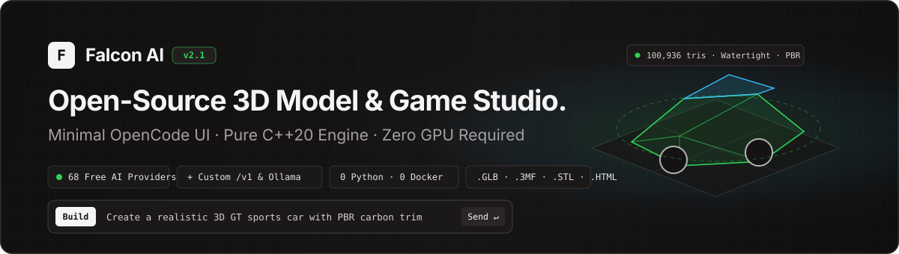
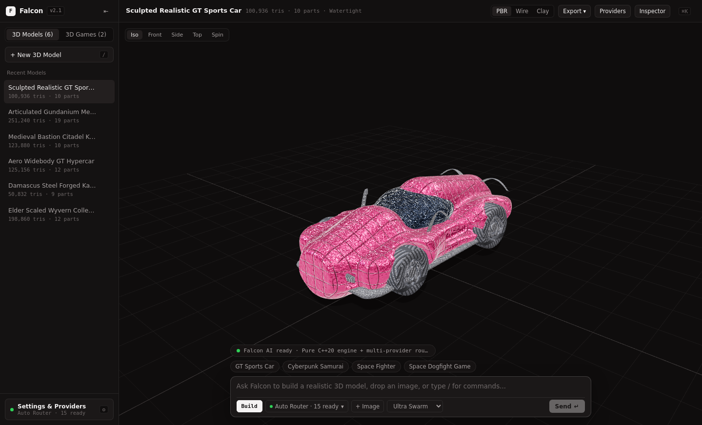
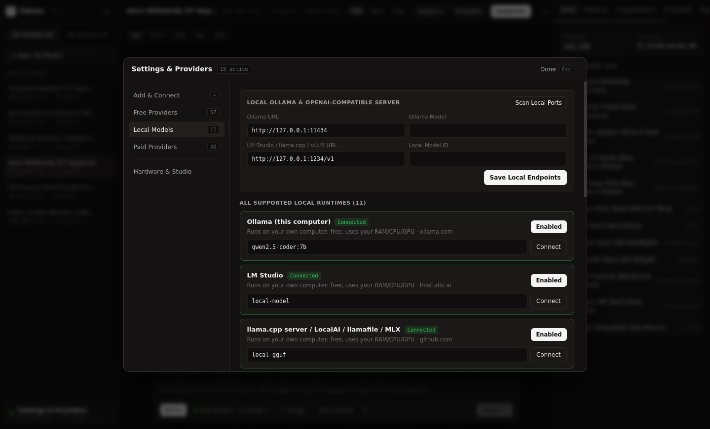
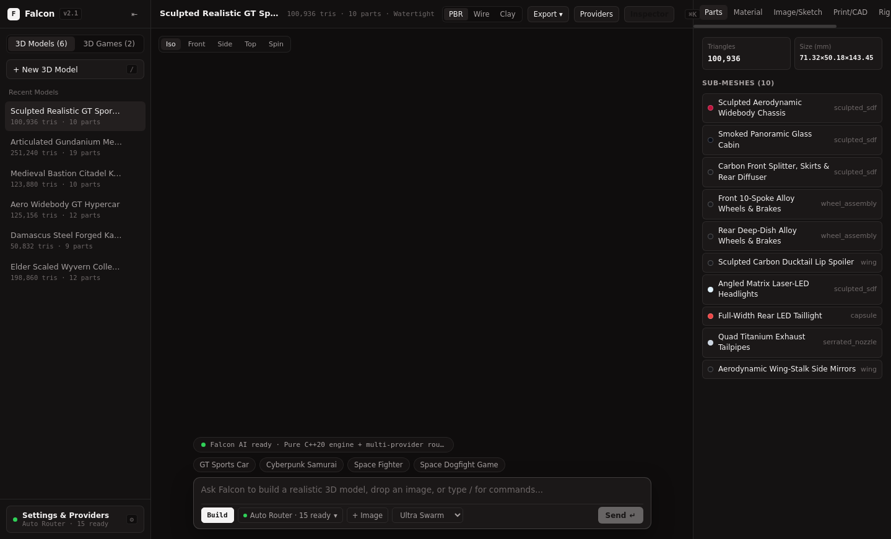
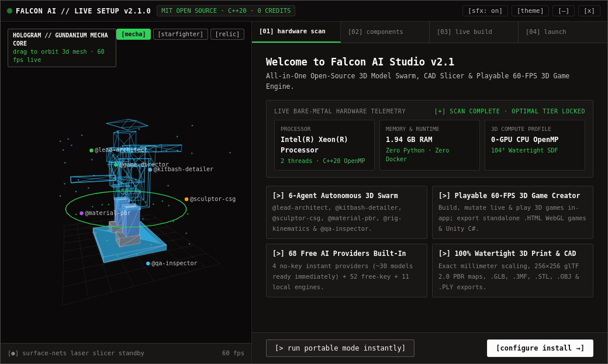

<div align="center">



<br />

[](https://github.com/esoexe/falcon-ai/releases/tag/v2.1.0)
[](#architecture)
[](#build-from-source)
[](#hardware-auto-detection--zero-gpu-mode)
[](#ai-providers--local-models-v21)
[](LICENSE)

<p align="center">
  <strong>Falcon AI</strong> is a 100% free, open-source desktop 3D model generator, CAD/print studio, and playable 60-FPS 3D game creator — powered by a native <strong>C++20</strong> geometry engine and a calm, distraction-free <strong>OpenCode Desktop</strong> interface.
</p>

<p align="center">
  <a href="https://github.com/esoexe/falcon-ai/releases/download/v2.1.0/Falcon-AI-Setup-2.1.0-x64.exe"><strong>⬇ Download Windows Installer (v2.1.0 .exe)</strong></a>
  &nbsp;·&nbsp;
  <a href="https://github.com/esoexe/falcon-ai/releases/download/v2.1.0/Falcon-AI-2.1.0-Source-Code.zip"><strong>📦 Source Archive (.zip)</strong></a>
  &nbsp;·&nbsp;
  <a href="#whats-new-in-v21"><strong>✨ What's New in v2.1</strong></a>
  &nbsp;·&nbsp;
  <a href="#ai-providers--local-models-v21"><strong>🔌 Configure Providers</strong></a>
  &nbsp;·&nbsp;
  <a href="CHANGELOG.md"><strong>📜 Changelog</strong></a>
</p>

</div>

---

## ✨ What's New in v2.1

Version **2.1** (`v2.1.0`) is a complete UI/UX and AI connectivity overhaul focused on **simplicity, speed, and open provider control**:

| Area | What Changed in Falcon AI v2.1 |
| :--- | :--- |
| **Minimal OpenCode UI** | Replaced dense multi-panel toolbars and bracketed buttons with a clean, calm **OpenCode Desktop** workspace: left session sidebar, single-row top header, full-bleed 3D stage, and a centered floating prompt composer. |
| **Settings & Providers Hub** | New 2-column **Settings & Providers** dialog (`Ctrl+,` or `/providers`) accessible from the bottom-left dock, top bar, or directly inside the prompt composer's router pill. |
| **Custom `/v1` Endpoints** | First-class **`+ Add Custom Provider`** form — connect any OpenAI-compatible server (`OpenRouter`, `LiteLLM`, `vLLM`, `DeepInfra`, self-hosted proxies) with custom Base URL, API Key, and Model ID. |
| **Local AI Runtime Hub** | Dedicated **Local Models** view with 1-click port scanning and editable endpoints for **Ollama** (`:11434`), **LM Studio** (`:1234`), **llama.cpp** (`:8080`), **vLLM** (`:8001`), and **ComfyUI** (`:8188`). |
| **On-Demand Studio Inspector** | Power tools (`Parts`, `Material`, `Image/Sketch`, `Print/CAD`, `Rig`, `Swarm`, `JSON`) now live in a clean slide-over drawer (`Ctrl+I`) that stays closed by default until you need it. |

---

## 📸 Falcon AI v2.1 Visual Tour

### 1. Minimal OpenCode 3D Workspace & Floating Prompt Composer
Clean session sidebar on the left, uncluttered single-row header on top, sculpted PBR-textured 3D viewport in the center, and the **OpenCode prompt bar** (`Build / Edit / Game / Plan`, `Auto Router` selector, `+ Image`, and quality toggle) at the bottom.



---

### 2. Universal AI Providers & Custom OpenAI-Compatible Endpoints
Switch routing modes (`Auto`, `Custom /v1`, `Local Ollama`, or `Offline C++20`), add unlimited **Custom OpenAI-Compatible Providers**, or paste an API key to quick-connect **Groq**, **GitHub Models**, **OpenRouter**, **Gemini**, **Mistral**, **DeepSeek**, **Cerebras**, and **50+ more free tiers**.


---

### 3. Local Models Hub (Ollama, LM Studio, llama.cpp & Port Scanner)
Run 100% offline on your own CPU/RAM/GPU. Configure local URLs and model IDs (`qwen2.5-coder:7b`, `llama3.2`, GGUF servers) and scan local ports in one click.



---

### 4. On-Demand Studio Inspector (Sub-Meshes, PBR Materials, CAD mm & 3D Print)
Click **`Inspector`** (`Ctrl+I`) whenever you want deep control over sub-mesh parts, 256×256 procedural PBR finishes, Image/Sketch-to-3D reconstruction, exact millimeter CAD scaling, watertight manifold repair, 0.25 mm alignment-pin splitting, or skeletal rigging.



---

### 5. Playable 60-FPS 3D Game Studio Inside the OpenCode Shell
Switch to **`3D Games`** (or press `Tab` to select `Game` mode in the prompt bar) to generate, play (`WASD` + `Space` + combat HUD), live-mutate, and export standalone single-file `.HTML` WebGL2 games or Unity `.CS` suites.


---

### 6. Live-Animated 3D Hologram `Setup.exe` (v2.1.0)
No gray legacy wizard — `Falcon-AI-Setup-2.1.0-x64.exe` launches an interactive 60-FPS 3D holographic installer with live hardware probing, Desktop/Start Menu shortcut creation, clean `HKCU` uninstaller support, and instant **Portable Mode**.



---

## 🔌 AI Providers & Local Models (v2.1)

Falcon AI never locks you behind credits or a single cloud vendor. Open **Settings & Providers** (`Ctrl+,`) to mix and match:

1. **Zero-Key Instant Providers (`5` built-in)**: Works on first launch with zero signup (`LLM7.io`, `Pollinations`, `Kilo Gateway`, etc.) plus the built-in C++20 parametric/sculpted SDF architect.
2. **Custom OpenAI-Compatible Endpoints (`Unlimited`)**: Add any `/v1/chat/completions` endpoint with custom `Name`, `Base URL`, `API Key`, and `Model ID` — persisted locally in `workspace_providers.json`.
3. **Free-Key Cloud Tiers (`52` providers)**: Free developer tiers from `Groq`, `GitHub Models`, `OpenRouter (:free)`, `Google AI Studio (Gemini)`, `Mistral La Plateforme`, `Cerebras`, `NVIDIA NIM`, `SambaNova`, `Cloudflare Workers AI`, `Hugging Face`, `Chutes.ai`, and more.
4. **Local Runtimes (`11` engines)**: `Ollama`, `LM Studio`, `llama.cpp`, `Jan`, `GPT4All`, `KoboldCpp`, `vLLM`, `TabbyAPI`, `ExLlamaV2`, `LocalAI`, and `ComfyUI`.
5. **Opt-In Paid Providers (`30` providers, OFF by default)**: `OpenAI`, `Anthropic`, `xAI Grok`, `Together`, `Fireworks`, `DeepSeek`, etc. — strictly disabled unless you explicitly add a key.

---

## ⚡ Core Capabilities

- **6-Agent C++20 3D Swarm**: `@lead-architect`, `@kitbash-detailer`, `@sculptor-csg`, `@material-pbr`, `@rig-kinematics`, and `@qa-inspector` collaborate to synthesize multi-part watertight meshes in under a second.
- **Native 256×256 glTF 2.0 PBR Baker**: Generates embedded PNG Albedo, Metallic/Roughness/AO (`ORM`), and Tangent-Space Normal maps across 13 procedural finishes (`brushed_metal`, `carbon_weave`, `metallic_flake`, `damascus`, `hammered_metal`, `ceramic`, `wood_grain`, `weathered_stone`, etc.).
- **Image-to-3D & Sketch-to-3D**: Click **`+ Image`** in the prompt bar (or drag-and-drop any PNG/JPEG onto the viewport) for C++20 O(N) Euclidean Distance Transform + Surface-Nets volumetric reconstruction, 2.5D relief, or backlit lithophanes.
- **Slicer-Ready 3D Printing & Exact CAD Millimeters**: Resize X/Y/Z to exact `mm`, slice flat build-plate bottoms, weld 2-manifold edges, auto-split oversized prints with `0.25 mm` snap-fit alignment pins, and export `.GLB`, `.3MF` (Bambu/Prusa/Orca), `.STL`, `.OBJ`, `.PLY`, and Unity `.CS`.
- **Hardware Auto-Detection & Zero-GPU Mode**: Automatically detects CPU cores, RAM, and GPU availability on startup — scaling OpenMP parallel Surface-Nets (`48³` to `128³`) so laptops without a dedicated GPU run smoothly out of the box.

---

## ⌨️ OpenCode Keyboard Shortcuts

| Shortcut | Action |
| :--- | :--- |
| `/` | Focus the bottom OpenCode prompt composer |
| `Tab` | Cycle prompt mode (`Build` → `Edit` → `Game` → `Plan`) |
| `Enter` | Run prompt (or `Shift+Enter` for newline) |
| `Ctrl + ,` | Open **Settings & Providers** (API keys, Custom `/v1`, Ollama) |
| `Ctrl + K` / `Ctrl + P` | Open **Command Palette** |
| `Ctrl + I` | Toggle right-hand **Studio Inspector** drawer |
| `Ctrl + B` | Collapse / expand left **Session Sidebar** |

---

## 🏗️ Architecture

```text
falcon-ai/
├── cpp_engine/                  # Pure C++20 Backend, 3D SDF/CSG Engine & HTTP Server (0 Python, 0 Docker)
│   ├── include/
│   │   ├── agent_swarm.hpp      # 6-Agent 3D synthesis & kitbashing pipeline
│   │   ├── csg_sdf.hpp          # OpenMP SDF/CSG evaluator + Surface-Nets + Taubin smoothing
│   │   ├── pbr_textures.hpp     # 256x256 Albedo / ORM / Normal PNG baker + glTF 2.0 .GLB writer
│   │   ├── provider_catalog.hpp # 98-provider registry + persistent Custom /v1 endpoints
│   │   ├── llm_router.hpp       # Word-boundary prompt router + Cloud/Local OpenAI & Ollama client
│   │   ├── image_to_3d.hpp      # O(N) EDT volumetric silhouette, relief & lithophane engine
│   │   ├── game_engine_builder.hpp # Playable 3D game world builder, mutator & HTML5/C# exporters
│   │   └── embedded_web.hpp     # Zlib-compressed single-binary VFS web bundle
│   └── src/
│       ├── main.cpp             # Cross-platform POSIX / Win32 HTTP server (bin/falcon_server[.exe])
│       └── pack_web.cpp         # Build-time VFS asset packer
├── frontend/                    # Minimal OpenCode Desktop React + Three.js WebGL2 Studio
│   └── src/
│       ├── App.jsx              # OpenCode sidebar, minimal header, 3D/Game stage & prompt composer
│       ├── styles.css           # Warm obsidian & cream monochrome design tokens
│       └── components/          # HardwareModal (Providers), Viewport3D, GameViewport, CommandPalette
└── desktop/                     # Electron Desktop App + 60-FPS 3D Hologram Setup.exe (Windows/Linux)
```

---

## 🛠️ Build from Source

Falcon AI compiles cleanly into a single self-contained native binary with **zero Python** and **zero Docker**:

### Linux (GCC 11+ / Clang 14+ with C++20 & OpenMP)

```bash
git clone https://github.com/esoexe/falcon-ai.git
cd falcon-ai

# 1. Build the OpenCode frontend & pack into C++20 embedded_web.hpp
cd frontend && npm ci && npm run build && cd ..
make web

# 2. Launch Falcon AI Studio on http://127.0.0.1:8000
./bin/falcon_server --host 127.0.0.1 --port 8000
```

### Windows x64 (`falcon_server.exe` + `Falcon-AI-Setup-2.1.0-x64.exe`)

```bash
# Cross-compile static zero-DLL Windows C++20 engine (or run compile_windows_cpp.bat on Windows)
make win

# Package the Windows x64 Setup.exe installer
cd desktop && npm ci && npm run build:win
```

---

## 📄 License

Released under the **[MIT License](LICENSE)** — 100% free for personal, academic, indie game, and commercial 3D production.
