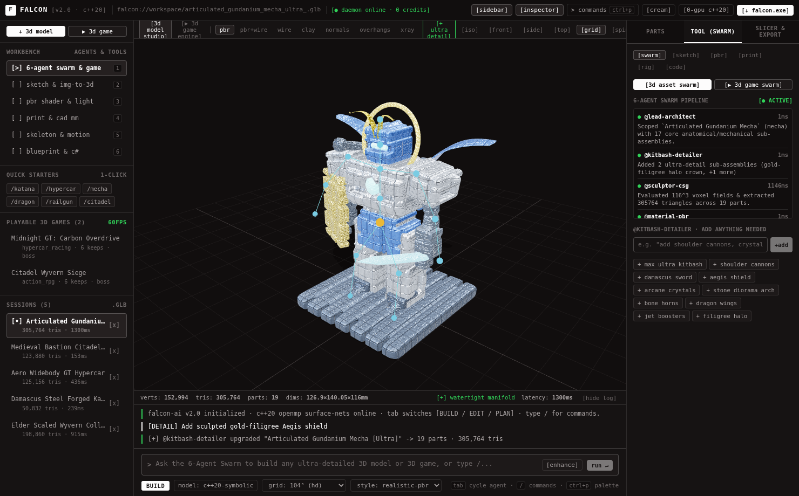
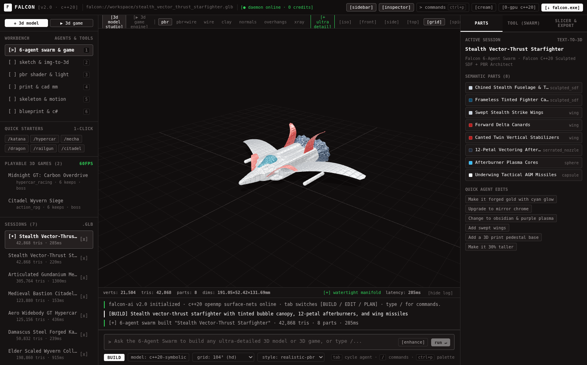
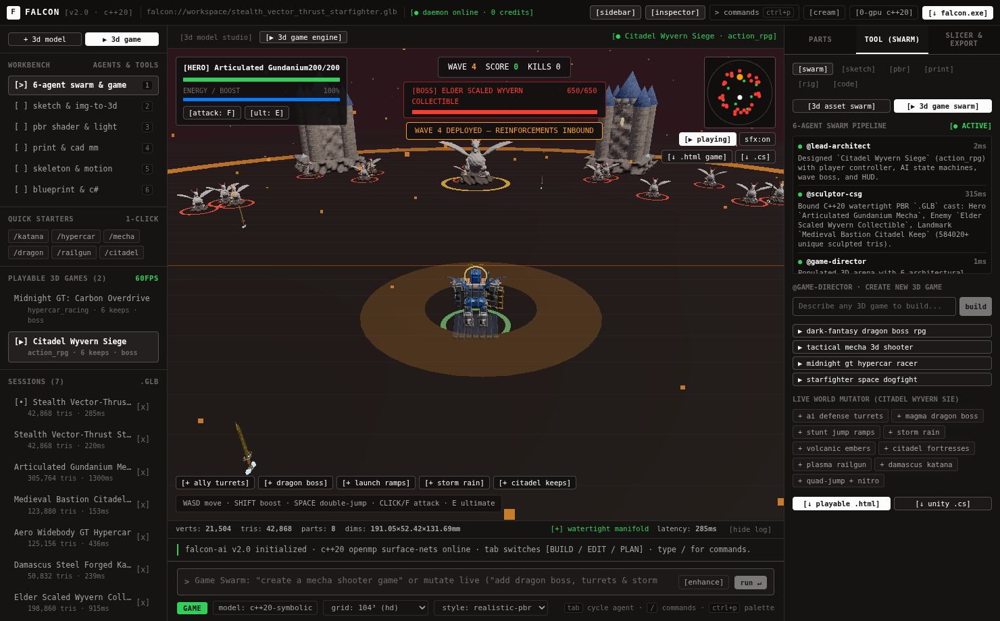
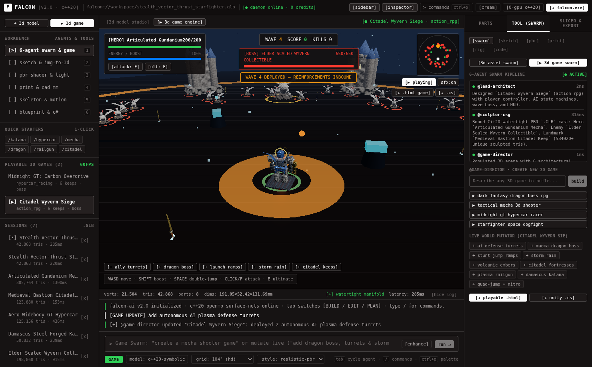
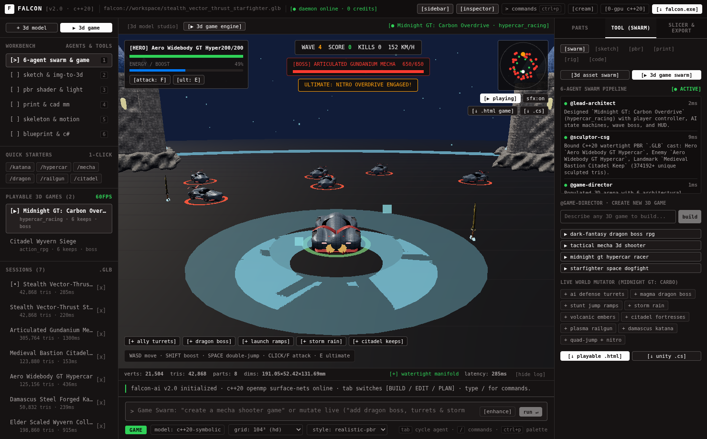
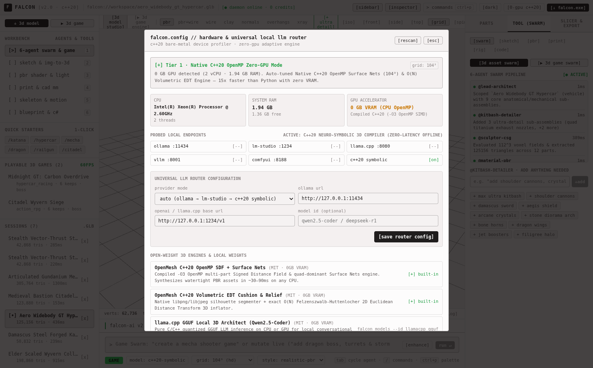

# Falcon AI (`Falcon`) v2.0

```text
███████╗ █████╗ ██╗      ██████╗ ██████╗ ███╗   ██╗       █████╗ ██╗
██╔════╝██╔══██╗██║     ██╔════╝██╔═══██╗████╗  ██║      ██╔══██╗██║
█████╗  ███████║██║     ██║     ██║   ██║██╔██╗ ██║█████╗███████║██║
██╔══╝  ██╔══██║██║     ██║     ██║   ██║██║╚██╗██║╚════╝██╔══██║██║
██║     ██║  ██║███████╗╚██████╗╚██████╔╝██║ ╚████║      ██║  ██║██║
╚═╝     ╚═╝  ╚═╝╚══════╝ ╚═════╝ ╚═════╝ ╚═╝  ╚═══╝      ╚═╝  ╚═╝╚═╝
   OPEN-SOURCE C++20 3D MODEL SWARM · CAD SLICER · PLAYABLE 3D GAME ENGINE
```

[](LICENSE)
[](cpp_engine/)
[](ARCHITECTURE.md)
[](FREE_AI_PROVIDERS_CATALOG.md)
[](https://github.com/esoexe/falcon-ai/releases/latest)

**Falcon AI** is a 100% free, MIT-licensed open-source alternative to Meshy.ai — engineered from scratch in **compiled C++20 + OpenMP** with an **OpenCode-inspired** warm monochrome UI, a **6-Agent Autonomous 3D Swarm**, a **60-FPS Playable 3D Game Creator**, **68 built-in free AI providers**, and a **Live-Animated 3D Holographic Windows `Setup.exe`**.

It runs seamlessly on **any machine — even laptops with 0 GB GPU VRAM** — automatically detecting your CPU, RAM, and GPU capabilities at startup.

---

## Live Studio & Playable 3D Game Engine Screenshots

### 6-Agent 3D Swarm & `@kitbash-detailer` (`305,764` Tris · `19` Parts · Watertight)


### Live Prompt-to-3D Synthesis (`285 ms` Zero-GPU Build & Semantic Parts)


### Playable 60-FPS 3D Game Engine (`Citadel Wyvern Siege` + Live World Mutator)



### Hypercar Racing Game (`Midnight GT: Carbon Overdrive`) & Zero-GPU Router



---

## Key Capabilities

- **Collaborating 6-Agent 3D Swarm (`cpp_engine/include/agent_swarm.hpp`)**
  - `@lead-architect` · `@kitbash-detailer` · `@sculptor-csg` · `@material-pbr` · `@rig-kinematics` · `@qa-inspector`
  - Synthesizes multi-part anatomical & hard-surface 3D models (`50K–300K+` triangles) with smooth Boolean CSG unions/cavities and `100%` 2-manifold watertightness.
  - **"Add Anything Needed" (`detail` Mode)**: Dynamically attach shoulder railguns, gold-filigree Aegis shields, dragon wings, Picatinny optics, hydraulic pistons, arcane crystal clusters, or stone diorama arches to any model.
- **Embedded 256×256 glTF 2.0 PBR Textures (`cpp_engine/include/pbr_textures.hpp`)**
  - Pure C++20 `libpng` procedural synthesis of **Albedo**, **Occlusion-Roughness-Metallic (ORM)**, and **Tangent-Space Normal** maps across **13 finishes** (`damascus_steel`, `dragon_scales`, `carbon_fiber`, `gold_filigree`, `obsidian_crystal`, `forged_metal`, `weathered_stone`, `rusted_iron`, `bark_wood`, `carved_bone`, `wrapped_leather`, `painted_armor`, `rubber_tire`).
- **Playable 60-FPS 3D Game Creator Engine (`GameViewport.jsx` & `game_engine_builder.hpp`)**
  - Build and play complete 3D games (`action_rpg`, `mecha_shooter`, `hypercar_racing`, `space_dogfight`) right inside the studio using your real C++20 `.GLB` models, complete with AI defense turrets, boss phases, stunt ramps, dynamic weather, WebAudio SFX, and radar minimap.
  - **Live World Mutator**: Add turrets, dragon bosses, storm rain, volcanic embers, or ramps while playing without restarting.
  - **1-Click Game Exports**: Export standalone single-file HTML5/WebGL `.html` games (with all `.GLB` assets Base64-embedded offline) and Unity C# (`.cs`) controller suites.
- **68 Free AI Providers + Universal Local LLM Router (`FREE_AI_PROVIDERS_CATALOG.md`)**
  - **5 No-Key Instant Providers** enabled on fresh install (`OVHcloud AI Endpoints`, `Kilo Gateway`, `LLM7`, `Pollinations`, `Puter.js`) — ~30 free models ready immediately with zero signup.
  - **52 Free-Key Tier Providers** (`Groq`, `Google Gemini`, `OpenRouter`, `Cerebras`, `NVIDIA`, `Mistral`, `Cloudflare Workers AI`, `GitHub Models`, `Hugging Face Router`, etc.).
  - **11 Local On-Computer Engines** (`Ollama`, `LM Studio`, `llama.cpp`, `vLLM`, `SGLang`, `Jan`, `GPT4All`, `KoboldCpp`, `TabbyAPI`, plus the built-in zero-latency **Falcon C++20 Symbolic Architect**).
  - **30 Paid Providers** included as strictly **OFF by default** opt-ins.
- **CAD Millimeter Precision, 3D Print Doctor & Unrestricted Exports**
  - Exact `X / Y / Z` millimeter scaling, non-manifold healing, flat slicer bed cut, `0.25mm`-clearance dowel-pin auto-splitting, 15-bone auto-rigging, and unrestricted `.GLB`, `.3MF`, `.STL`, `.OBJ`, `.PLY`, `.CS`, and `.HTML` exports (`0` credits, `0` paywalls).
- **Live-Animated 3D Holographic `Setup.exe` (`desktop/installer/setup.html`)**
  - Replaces boring Win32 gray wizard dialogs with a frameless **60-FPS interactive 3D Hologram & Laser-Slicer Setup Wizard** featuring live hardware radar scanning, custom install path & module toggles, real Windows `.lnk` Desktop/Start Menu shortcuts, clean HKCU uninstaller registration, and an instant Portable Mode option.

---

## Repository Structure

```text
falcon-ai/
├── cpp_engine/                    # Pure Compiled C++20 Backend & 3D Geometry Engine (0 Python)
│   ├── include/
│   │   ├── agent_swarm.hpp        # 6-Agent Autonomous 3D Synthesis & @kitbash-detailer Swarm
│   │   ├── exporters.hpp          # Binary glTF 2.0 (.GLB), PKZIP .3MF, .STL, .OBJ, .PLY I/O
│   │   ├── game_engine_builder.hpp# Multi-Agent 3D Game Manifest, Mutator, .HTML & Unity C# Exporter
│   │   ├── hardware.hpp           # Bare-Metal CPU / RAM / VRAM Profiler & Zero-GPU Tier Tuner
│   │   ├── http_server.hpp        # Multithreaded POSIX / Winsock2 HTTP/1.1 Server
│   │   ├── image_to_3d.hpp        # O(N) Felzenszwalb-Huttenlocher EDT Volumetric Sketch/Image-to-3D
│   │   ├── json.hpp               # Header-only RFC 8259 JSON Parser & Serializer
│   │   ├── llm_router.hpp         # libcurl LLM Router + C++20 Multi-Part Blueprint Architect
│   │   ├── marching_cubes.hpp     # Parallel OpenMP Surface-Nets + 6-Pass Taubin Mesh Extractor
│   │   ├── math3d.hpp             # SIMD-friendly Vec3, Mat4, Quat & AABB Math Primitives
│   │   ├── mesh.hpp               # Manifold Repair, Decimation, Subdivision & Dowel-Pin Cutter
│   │   ├── pbr_textures.hpp       # libpng 256×256 Albedo, ORM & Normal Map Synthesizer (13 Finishes)
│   │   ├── provider_catalog.hpp   # 98-Provider Registry (68 Free + 30 Opt-In Paid)
│   │   └── sdf_compiler.hpp       # Smooth Boolean CSG & Parametric Kitbash Mesh Compiler
│   └── src/
│       ├── main.cpp               # HTTP/1.1 API + Embedded zlib-9 WebGL Studio Host (:8000)
│       ├── pack_web.cpp           # Compiles frontend bundle into C++20 zlib-9 VFS header
│       ├── openmesh_ctl.cpp       # Native POSIX Daemon Controller (start / stop / status)
│       └── models_cli.cpp         # Native C++20 Open-Weight Model Manager CLI
├── frontend/                      # OpenCode-Inspired React + Three.js WebGL2 Studio & Game Engine
│   └── src/
│       ├── App.jsx                # Collapsible 3-Pane OpenCode Workbench, Modes & Slash Commands
│       ├── styles.css             # Warm Monochrome OpenCode Design System (#131010 / #fdfcfc)
│       └── components/
│           ├── Viewport3D.jsx     # Studio PBR, Wireframe, Clay, Overhang & 15-Bone Rig Viewport
│           ├── GameViewport.jsx   # Playable 60-FPS 3D Game Engine + Radar + Live World Mutator
│           ├── SwarmPanel.jsx     # 6-Agent Pipeline Trace, @kitbash-detailer & @game-director
│           ├── HardwareModal.jsx  # Settings -> 98 AI Providers & Bare-Metal Hardware Profiler
│           ├── SketchPad.jsx      # Interactive 2D Brush Canvas -> Volumetric Image-to-3D
│           └── CommandPalette.jsx # Ctrl+P Fuzzy Command Launcher
├── desktop/                       # Standalone Electron Desktop App & Live-Animated Setup.exe
│   ├── installer/setup.html       # 60-FPS Interactive 3D Hologram & Laser-Slicer Setup Wizard
│   ├── electron/
│   │   ├── main.js                # Frameless Dual-Mode Setup / Studio Window & C++20 Daemon Host
│   │   ├── installer_engine.js    # Real Windows Install, .lnk Shortcuts & Clean HKCU Uninstaller
│   │   ├── fallback_engine.js     # Zero-Toolchain Embedded Offline Geometry & Game Host
│   │   └── preload.js             # Context-Isolated Desktop & Installer IPC Bridge
│   └── package.json               # electron-builder configuration -> Falcon-AI-Setup-2.0.0-x64.exe
├── packaging/                     # Native Bare-Metal OS Services (systemd, launchd, Windows Service)
├── Makefile                       # 1-Command Frontend + VFS Pack + C++20 Build System
├── compile_windows_cpp.bat        # Native Windows MinGW-w64 / MSYS2 C++20 Build Script
└── FREE_AI_PROVIDERS_CATALOG.md   # Complete Reference of All 68 Free + 30 Opt-In AI Providers
```

---

## Quickstart — Build & Run From Source

### Prerequisites
- **C++20 Compiler**: GCC 11+ or Clang 14+ (Linux/macOS), or MinGW-w64 GCC 13+ (Windows) with `libcurl`, `libpng`, `libjpeg`, and `zlib`.
- **Node.js 18+** & `npm` (for building the React + Three.js WebGL bundle and optional Electron `.exe`).

### 1. Linux / macOS Build (Single Self-Contained C++20 Binary)

```bash
# 1. Build the WebGL2 Studio bundle
cd frontend
npm install
npm run build
cd ..

# 2. Pack WebGL VFS (zlib -9) & compile all C++20 binaries with OpenMP + -O3
make -j$(nproc)

# 3. Launch Falcon AI Studio on http://localhost:8000
./bin/falcon_server --port 8000
```

You can also manage Falcon AI as a background daemon without containers:
```bash
./bin/falcon_ctl start
./bin/falcon_ctl status
./bin/falcon_ctl stop
```

### 2. Windows Build & Live-Animated `Setup.exe` Packaging

```bash
# Optional: Compile native Windows C++20 daemon with MinGW-w64
compile_windows_cpp.bat

# Build the Live-Animated Windows x64 Setup.exe
cd desktop
npm install
cp -r ../frontend/web_bundle ./web_bundle
npm run build:win
# Output -> releases/Falcon-AI-Setup-2.0.0-x64.exe
```

To preview the **Live-Animated 3D Holographic Setup Wizard** during development:
- In Desktop mode: `cd desktop && npm run start:setup`
- In Browser mode: open `http://localhost:8000/setup`

---

## License

Released under the [MIT License](LICENSE). 100% free for personal, academic, and commercial 3D & game creation.
