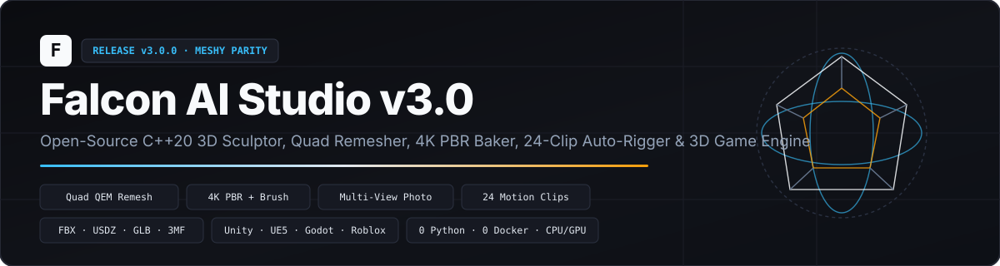
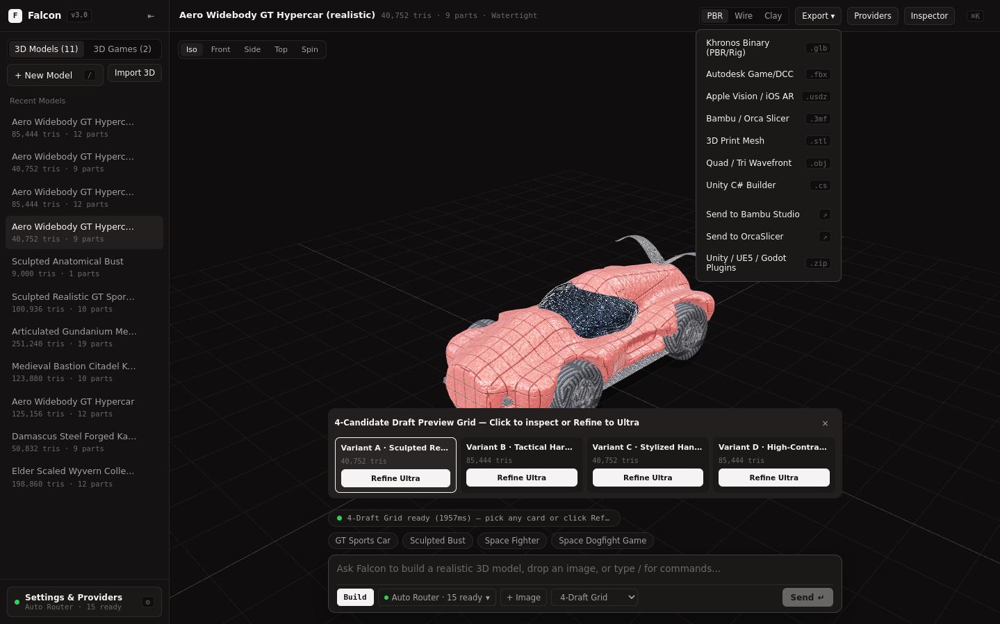
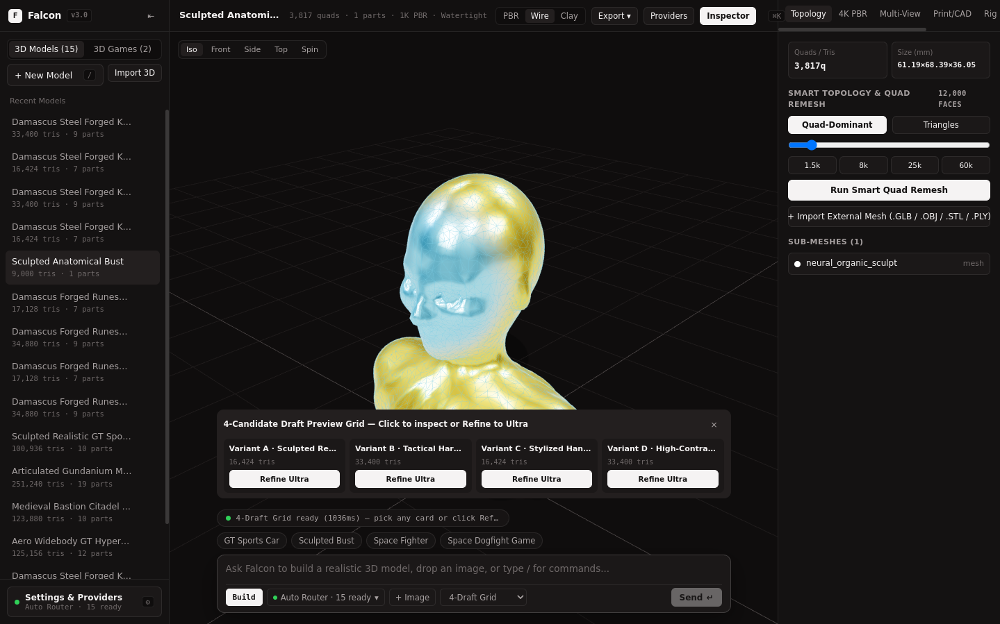
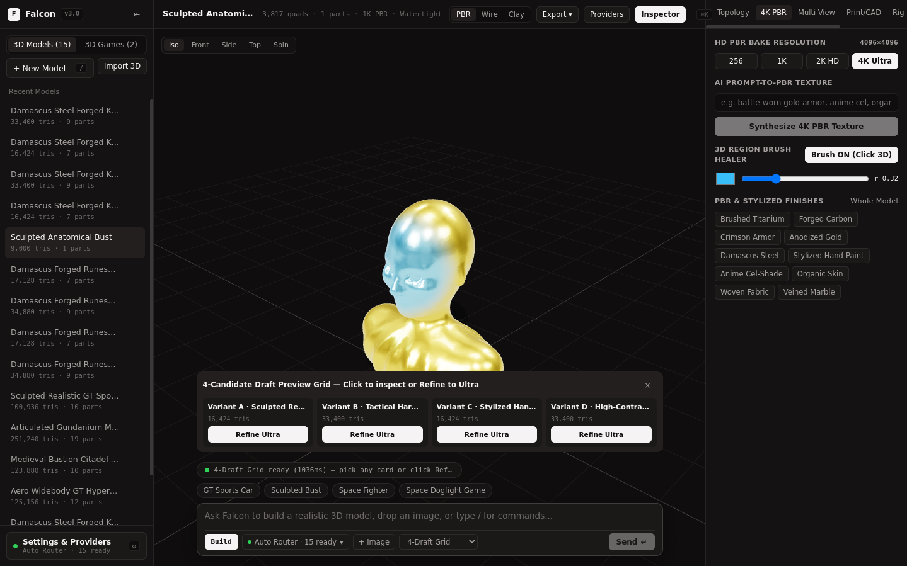
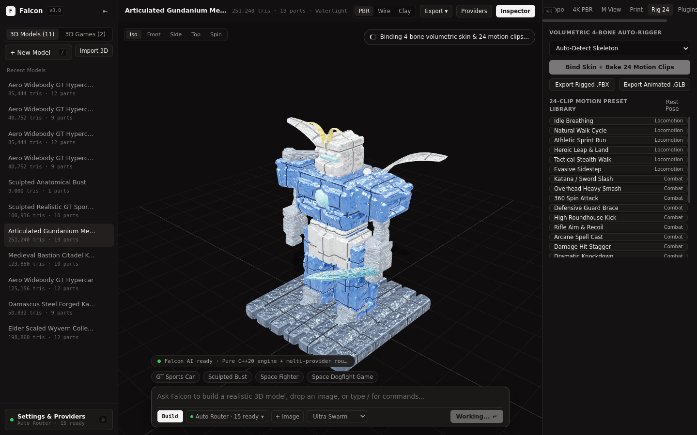
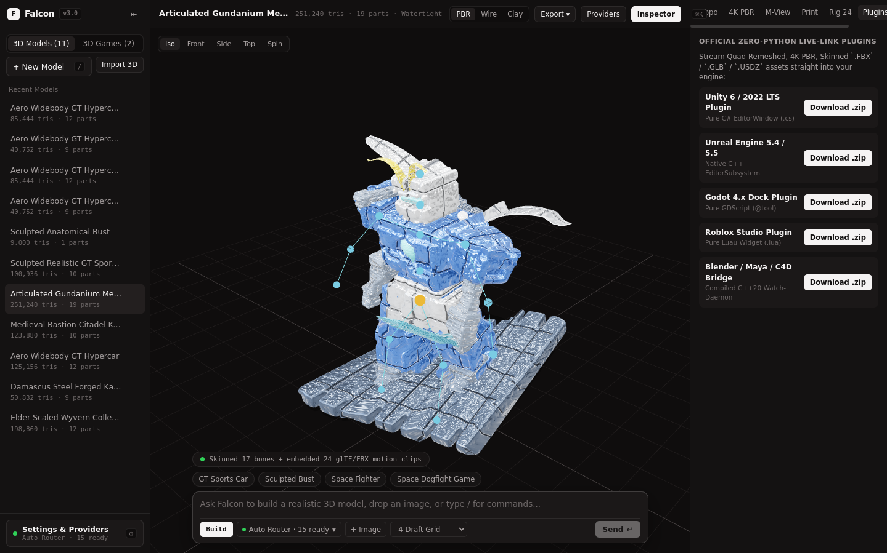

<p align="center">
  
</p>

<p align="center">
  <a href="https://github.com/esoexe/falcon-ai/releases/tag/v3.0.0"></a>
  <a href="https://github.com/esoexe/falcon-ai/releases/download/v3.0.0/Falcon-AI-Setup-3.0.0-x64.exe"></a>
  
  
  
</p>

# Falcon AI Studio `v3.0` — Full Open-Source 3D Creation, Quad Remeshing, 4K PBR, Auto-Rigging & Playable 3D Game Studio

**Falcon AI (`v3.0.0`)** is a **100% free, zero-credit, zero-Python, zero-Docker C++20 3D AI Studio** built around the ultra-clean **OpenCode Desktop** aesthetic. It runs natively on **any hardware — even laptops without a dedicated GPU** — automatically detecting CPU threads, RAM, GPU VRAM, and local LLM servers (`Ollama`, `LM Studio`, `llama.cpp`, `vLLM`, `ComfyUI`) alongside **68 free cloud/local AI providers** (and 30 optional BYOK providers).

---

## What's New in `v3.0.0` (Full Meshy AI Parity Release)

| Capability | Meshy AI 7.1 (Cloud SaaS) | Falcon AI `v3.0` (Open-Source C++20) |
| :--- | :--- | :--- |
| **Pricing & Offline Privacy** | Paid monthly credits · Cloud-only | **100% Free MIT · Runs Offline on CPU or GPU** |
| **4-Candidate Draft Grid** | 4 fast drafts -> Refine | **4-Candidate Parallel Draft Strip (`Refine Ultra`)** |
| **Organic Character / Bust Sculpting** | Neural diffusion | **C++20 Implicit SIREN + Smooth Anatomical Metaball Field** |
| **Multi-View Image-to-3D** | 1–4 photos -> 3D | **1–4 View (`Front`/`Side`/`Back`/`Top`) Visual Hull + Photo RGB Projection** |
| **External Mesh Import & Retexture** | Upload `.OBJ`/`.FBX`/`.GLB` | **Native `.GLB`, `.OBJ`, `.STL`, `.PLY` Importer + Retexturing** |
| **HD PBR Texture Baking & Brush** | 2K/4K PBR + Region Edit | **OpenMP `256` / `1K` / `2K HD` / `4K Ultra` PBR + AI Prompt-to-PBR + 3D Region Brush** |
| **Smart Topology & Quad Remesh** | `100`–`300k` Quad/Tri | **Garland-Heckbert 4×4 QEM (`100`–`300,000` faces) + True 4-Gon Quad Retopology** |
| **Skeletal Skinning & Animations** | Auto-rig + motion library | **Volumetric 4-Bone `JOINTS_0`/`WEIGHTS_0` Skinning + 24 Embedded Motion Clips** |
| **Pro DCC, AR & Slicer Exports** | `FBX`, `USDZ`, `GLB`, `3MF`, `STL`, `OBJ` | **`.FBX` (7.4 Skin+Anim), `.USDZ` (64-Byte Aligned Apple AR), `.GLB`, `.3MF`, `.STL`, `.OBJ`, `.PLY`, `.CS` + 1-Click Bambu/Orca/Prusa/Cura** |
| **Official Engine Live-Link Plugins** | Unity, Unreal, Blender, Godot, Roblox | **Zero-Python Plugins: Unity (`C#`), UE5 (`C++`), Godot 4 (`GDScript`), Roblox (`Luau`), Blender/Maya (`C++20` Watch-Daemon)** |
| **Playable 60-FPS 3D Game Builder** | Not supported | **Built-in 6-Agent Playable 3D Game Creator + Standalone HTML5 & Unity C# Export** |

---

## Visual Tour (`v3.0` Live Desktop Captures)

### 1. Minimal OpenCode `v3.0` Workspace, 4-Candidate Draft Grid & `.FBX` / `.USDZ` / Slicer Exports


### 2. Smart Topology & Garland-Heckbert QEM Quad Remeshing + External Mesh Import


### 3. `4K Ultra` PBR Texture Baker, AI Prompt-to-PBR & Live 3D Region Brush Healer


### 4. Volumetric 4-Bone Auto-Rigger & 24-Clip Categorized Motion Library


### 5. 17-Bone Skeleton X-Ray & Zero-Python Unity / UE5 / Godot / Roblox / Blender Live-Link Plugins


### 6. Unified Provider Settings (`98` Providers + Custom Endpoints + Local Ollama Auto-Scanner) & Playable 3D Games
| Settings & Providers (`Ctrl+,`) | Playable 60-FPS 3D Game Mode |
| :---: | :---: |
|  |  |

---

## Quick Download & Build From Source

### Option A — Windows x64 Standalone Desktop App (`Setup.exe`)
Download **[`Falcon-AI-Setup-3.0.0-x64.exe`](https://github.com/esoexe/falcon-ai/releases/download/v3.0.0/Falcon-AI-Setup-3.0.0-x64.exe)** from the [Latest `v3.0.0` Release](https://github.com/esoexe/falcon-ai/releases/tag/v3.0.0). No Python, Docker, or GPU required — bundles both `falcon_server.exe` and `falcon_dcc_bridge.exe`.

### Option B — Native C++20 Build (Linux / Windows MinGW)
```bash
git clone https://github.com/esoexe/falcon-ai.git
cd falcon-ai

# Build Frontend VFS + Native C++20 Engine + DCC Watch-Bridge
cd frontend && npm install && cd ..
make web && make -j4 all

# Launch Falcon AI Studio on http://localhost:8000
./bin/falcon_server --port 8000
```

---

## Official Zero-Python Engine Live-Link Plugins (`plugins/`)

- **Unity 6 / 2022 LTS (`plugins/unity/FalconAILiveLink.cs`)**: Drop into `Assets/Editor/` and open `Window -> Falcon AI Studio v3.0` to generate Quad-Remeshed, 4K PBR, Skinned `.FBX` / `.GLB` assets straight into `Assets/FalconAI/`.
- **Unreal Engine 5.4 / 5.5 (`plugins/unreal/FalconAILiveLink.{h,cpp}`)**: Native C++ `UEditorSubsystem` importing rigged `.FBX` assets into `/Game/FalconAI`.
- **Godot 4.x (`plugins/godot/`)**: Pure GDScript `@tool` EditorPlugin spawning rigged `.GLB` scenes directly into your edited 3D scene root.
- **Roblox Studio (`plugins/roblox/FalconAILiveLink.lua`)**: Pure Luau DockWidgetPluginGui connected to local `:8000`.
- **Blender / Maya / Cinema 4D (`bin/falcon_dcc_bridge`)**: Compiled C++20 Watch-Folder Hot-Sync Daemon (`./bin/falcon_dcc_bridge --watch ./dcc_live_link`) with **zero Python scripts**.

---

## License

Released under the **MIT License** — free forever for personal, indie, studio, and commercial use.
